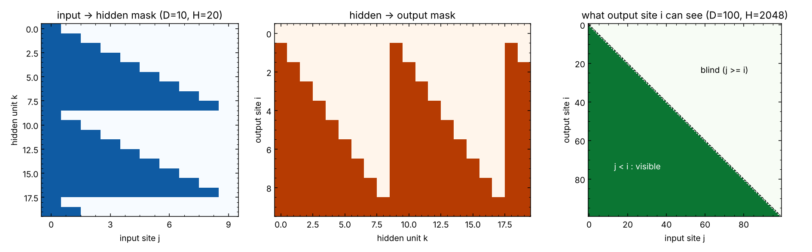
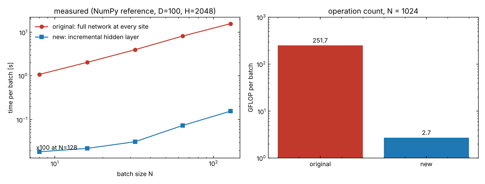
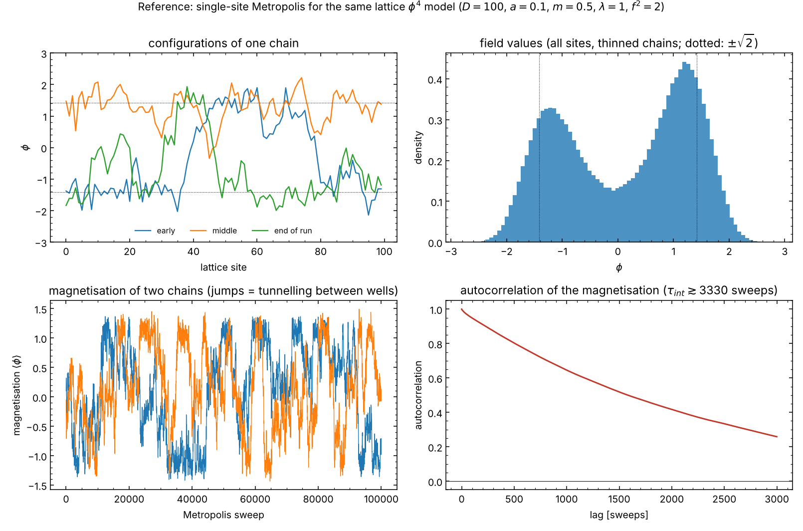

# Autoregressive sampling for MCMC: lattice φ⁴

A MADE-style autoregressive network (TensorFlow) trained to sample the one-dimensional lattice φ⁴ field theory
(100 sites, double-well potential) directly, so that configurations are independent draws instead of a slowly
decorrelating Markov chain. Each site is modelled as a two-Gaussian mixture conditioned on all previous sites,
and the network is trained by minimising the reverse KL divergence against the lattice action.

| File | What it is |
|---|---|
| `madesym.ipynb` | original notebook (TFP `AutoregressiveNetwork`, one full network call per site when sampling) |
| `madesym_fast.ipynb` | same model with a hand-written masked layer and an incremental sampler (details below) |
| `make_figures.py` | NumPy/matplotlib only; regenerates everything in `figures/` |

## Model

Action (as in `Energy()` in the notebooks), periodic boundary, lattice spacing a = 0.1:

S[φ] = Σᵢ [ m/(2a) (φᵢ − φᵢ₊₁)² + a λ (φᵢ² − f²)² ],  m = 0.5, λ = 1, f² = 2

so the field sits near the two minima φ = ±√2 and configurations are domain-wall-like mixtures of both.
The network gives p(φᵢ | φ₁…φᵢ₋₁) as a mixture of two Gaussians (parameters: two means, two widths, one weight);
the sample probability is the product over sites, and the loss is the reverse KL, estimated from samples with a
score-function (REINFORCE) gradient.



Masks make output site *i* depend only on inputs *j < i* (right panel, checked numerically in `make_figures.py`).

## What was slow, and the fix

Sampling must go site by site, because site *i* needs the sampled value of site *i−1*. The original code ran the
**whole** network (all 100 sites × 5 outputs) at every step and kept one output, so one batch cost about
D × (full forward pass). Two further costs were hiding in training: the network was evaluated again for
log-probabilities and again for the loss.

`madesym_fast.ipynb`:

* **Incremental hidden layer.** Once x_i is drawn, the hidden pre-activation only changes by one row of W1
  (`h_pre += 0.5 * x_i * W1[i]`), and only site *i*'s 5 outputs are computed from it. Per site this is
  O(H·P) instead of O(D·H + H·D·P).
* The loop runs in a single `tf.while_loop` inside `tf.function`, so there is no Python overhead per site.
* One fused `train_step`: a single network evaluation yields both log-probability and the sample, with the
  `KL_D` term stop-gradient'ed.



The left panel is **measured with a NumPy reference implementation of both schemes** (same random numbers; the
two give identical samples to ~1e-5), not with TensorFlow. The right panel is the operation count for N = 1024.
Absolute times in TensorFlow on your hardware will differ; the notebook has its own timing cell
(`NN_Sample_slow` vs the new sampler) to measure it.

## Reference: what the target looks like

The same action sampled with a single-site Metropolis update (100 000 sweeps, 8 chains, acceptance 0.46).
Field values are bimodal around ±√2, and the magnetisation tunnels between the two wells slowly: the
integrated autocorrelation time is thousands of sweeps. This is the problem the autoregressive sampler is meant
to avoid, since its samples are independent.



## Run

```bash
pip install tensorflow numpy matplotlib
jupyter lab madesym_fast.ipynb     # training: 20 epochs x 1000 iterations x 1024 samples, checkpoints in ./saved_models_MADE/
python make_figures.py             # figures only; add --quick for a short run
```

## Status

The `madesym_fast.ipynb` sampler and the figures above were validated with NumPy equivalents; the TensorFlow
notebook itself has not yet been run end to end by the author of these edits, and there are no trained-model results
in this repository yet. Once a model is trained, a natural addition is the histogram of sampled φ and
⟨φ²⟩ against the Metropolis reference above (⟨φ²⟩ ≈ 1.4 here).
